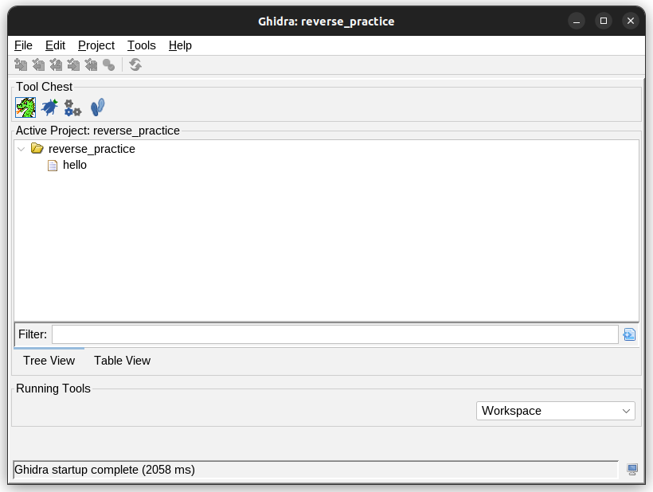
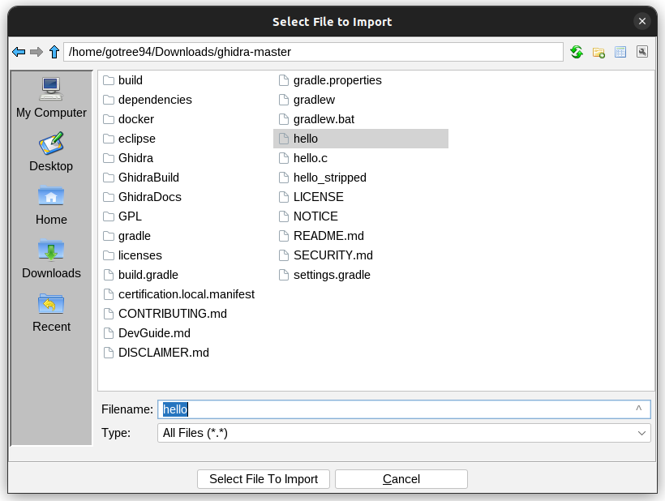
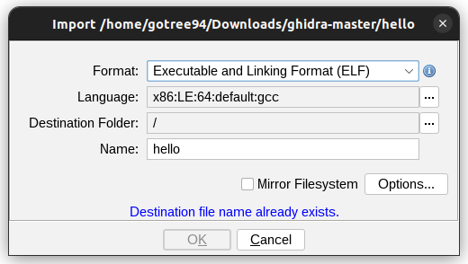
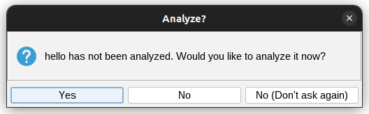
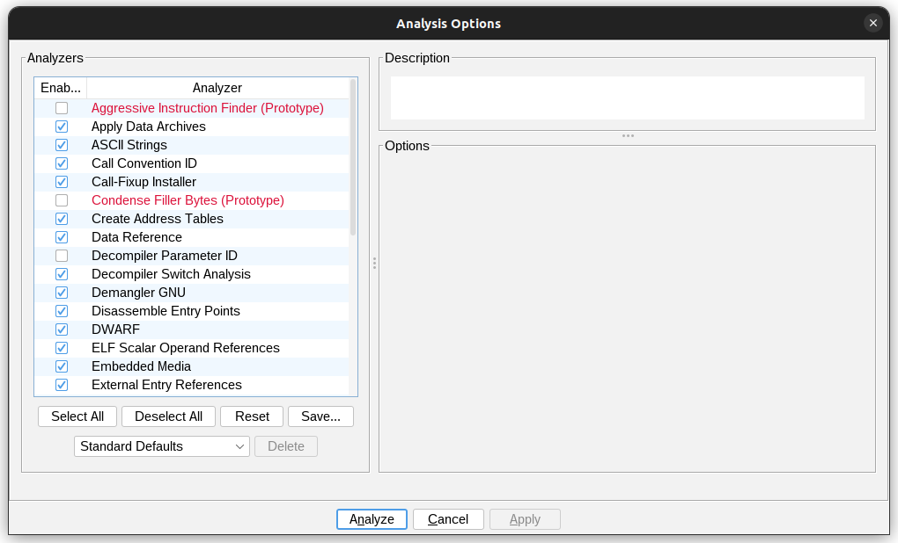
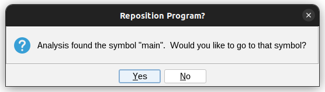
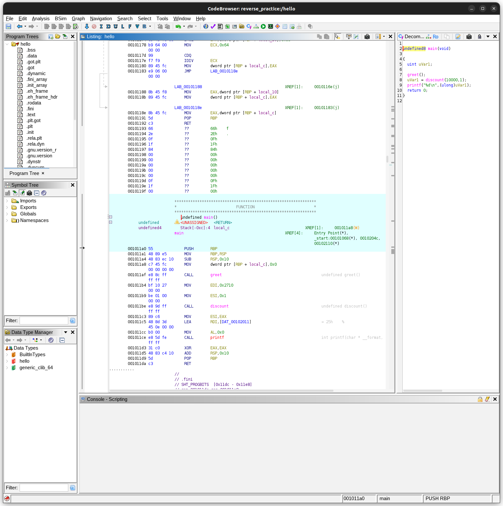

# Ghidra 리버싱 실습 환경 설정 및 검증 (hello.c)

작성일: 2026-11-06
범위: 환경 준비 → 샘플 컴파일 → Ghidra에서 `hello` 열기 및 확인 (3단계까지)

---

## 1. PC 환경

| 항목 | 내용 |
|---|---|
| OS | Ubuntu 22.04.5 LTS, kernel 6.8 |
| CPU | Intel Core Ultra 9 275HX (24 threads) |
| RAM | 62GiB (64GB) |
| GPU | NVIDIA RTX 5090 Laptop GPU, 24463 MiB, driver 580.159.04 |
| 실습 폴더 | `~/Downloads/ghidra-master` |

---

## 2. 개발 환경 설정

### 2.1 컴파일러 (clang)

처음에 `calng`로 오타를 내서 `command not found`가 났고, 철자를 고친 뒤에도 clang 자체가 미설치 상태였다.

```bash
sudo apt update
sudo apt install clang
clang --version
```

> gcc를 쓰려면 `sudo apt install build-essential` 후 `gcc -O0 hello.c -o hello`.

### 2.2 분석 도구

```bash
sudo apt install binutils gdb      # objdump, nm, readelf, strip, gdb
```

### 2.3 JDK

Ghidra 실행/빌드에는 **JDK**(javac 포함)가 필요하다. JRE만으로는 안 된다.

```bash
sudo apt install openjdk-21-jdk
java -version
javac -version
```

필요한 JDK 버전은 Ghidra 버전에 따라 다르다. 실행 시 버전 불일치 메시지가 나오면 그 안내를 따른다.

### 2.3.1 Ghidra 준비 (소스 빌드를 사용한 경우)

`~/Downloads/ghidra-master`는 **소스 코드**라서 그대로는 `ghidraRun`이 없다. 빌드하거나 릴리스 zip을 받아야 한다.

겪었던 문제:

| 증상 | 원인 | 조치 |
|---|---|---|
| `cd ghidra_*_PUBLIC` 실패 | 릴리스 zip이 아니라 소스만 있었음 | 릴리스를 받거나 소스에서 빌드 |
| `gradle` 4.4.1에서 daemon 시작 실패 | apt의 Gradle이 너무 오래됨 | 최신 Gradle 사용 (SDKMAN 등) |
| `Unrecognized VM option 'UseCompactObjectHeaders'` | master 소스가 JDK 21보다 새로운 JDK를 전제로 함 | README가 요구하는 JDK 버전으로 맞춤 |

빌드 절차 (환경에 맞는 JDK/Gradle을 준비한 뒤):

```bash
cd ~/Downloads/ghidra-master
gradle -I gradle/support/fetchDependencies.gradle
gradle buildGhidra
ls build/dist/
```

빌드 결과 zip을 풀어서 실행한다.

```bash
cd build/dist
unzip ghidra_*.zip
cd ghidra_*
./ghidraRun
```

> 빌드 시 실제로 사용한 JDK/Gradle 버전은 아래에 직접 기록해 둔다.
>
> - JDK: ______________
> - Gradle: ______________
> - Ghidra 버전: ______________

> 대안: GitHub Releases의 `ghidra_<버전>_PUBLIC_<날짜>.zip`("Source code"가 아닌 Assets 쪽)을 받아 풀고 `./ghidraRun`.

---

## 3. 샘플 프로그램

### 3.1 hello.c

```c
#include <stdio.h>

void greet(void) { printf("Hello World\n"); }

int discount(int price, int is_number){
	if (is_number) return price * 90 / 100;
	return price;
}

int main(void){
	greet();
	printf("%d\n", discount(10000, 1));
	return 0;
}
```

### 3.2 컴파일

```bash
cd ~/Downloads/ghidra-master
clang -O0 -g0 hello.c -o hello                 # 심볼 있음
cp hello hello_stripped && strip hello_stripped # 심볼 제거본 (연습용)
```

- `-O0`: 최적화를 끄므로 `greet`, `discount`가 인라인되지 않고 별도 함수로 남는다.
- `-g0`: 디버그 정보 없음.

### 3.3 실행 결과 (예상 출력)

```bash
./hello
```

```
Hello World
9000
```

---

## 4. 정답 확인 (Ghidra 없이)

Ghidra 결과와 비교할 기준값을 먼저 확보한다.

```bash
file hello
strings hello | grep -i hello
objdump -d -M intel hello | grep -A 20 "<discount>:"
nm hello | grep -E ' (main|greet|discount)$'
readelf -h hello_stripped | grep Entry
```

확인 포인트:

- `discount`에서 `imul`(×90)과 `idiv`(÷100)가 보인다.
- 인자는 System V ABI에 따라 `edi`=10000, `esi`=1.
- 반환값은 `eax`=9000.

(선택) gdb로 동적 확인:

```bash
gdb ./hello
(gdb) break discount
(gdb) run
(gdb) info registers rdi rsi
(gdb) finish
```

---

## 5. Ghidra에서 hello 열기 (3단계까지 검증 완료)

1. `File → New Project → Non-Shared Project` 로 프로젝트 생성 (예: `reverse_practice`).
2. `File → Import File` 에서 `~/Downloads/ghidra-master/hello` 선택.
   - Format: `Executable and Linking Format (ELF)`
   - Language: `x86:LE:64:default` (자동 선택)
3. 프로젝트 창에서 `hello` 더블클릭 → CodeBrowser 열기.
4. "Analyze?" → Yes → 기본 옵션으로 Analyze.

### 5.1 최종 검증 체크리스트

- [x] Ghidra(CodeBrowser)가 실행된다.
- [x] `hello`가 ELF x86-64로 임포트되고 자동 분석이 완료된다.
- [x] Symbol Tree → Functions에서 `main`, `greet`, `discount`가 보인다.
- [x] `discount` 디컴파일 결과가 아래와 같은 형태이다.

```c
int discount(int price, int is_number)
{
  if (is_number != 0) {
    price = (price * 0x5a) / 100;
  }
  return price;
}
```

- [x] `main`에서 `greet()` 호출 → `discount(10000, 1)` 호출 → `printf("%d\n", ...)` 흐름이 보인다.
- [x] `Window → Defined Strings`에서 `"Hello World"`, `"%d\n"`을 찾고 `Ctrl+Shift+F`로 참조 위치를 따라갈 수 있다.

---

## 6. 참고: 다음 단계에서 주의할 점

`hello_stripped`(심볼 제거본)를 열면 함수 이름이 `FUN_001xxxxx` 꼴로 나온다. 이때 주의:

- `FUN_00101020` 같은 낮은 주소의 함수는 main이 아니라 **`.plt` 영역**(PLT 스텁)일 가능성이 높다.
- main은 `entry`의 `__libc_start_main` **첫 번째 인자**로 찾는다.
- 또는 `hello`에서 `nm`으로 얻은 주소에 이미지 베이스 `0x100000`을 더한 주소로 `G`(Go To) 이동한다.

예시(주소는 직접 확인할 것):

```bash
nm hello | grep -E ' (main|greet|discount)$'
readelf -h hello_stripped | grep Entry
```

---

## 7. 명령어 요약

```bash
# 설치
sudo apt update
sudo apt install clang binutils gdb openjdk-21-jdk

# 컴파일
cd ~/Downloads/ghidra-master
clang -O0 -g0 hello.c -o hello
cp hello hello_stripped && strip hello_stripped

# 확인
./hello
objdump -d -M intel hello | grep -A 20 "<discount>:"
nm hello | grep -E ' (main|greet|discount)$'

# Ghidra 실행
cd <ghidra 설치 폴더>
./ghidraRun
```

 <br>
 <br>
 <br>
 <br>
 <br>
 <br>
 <br>


